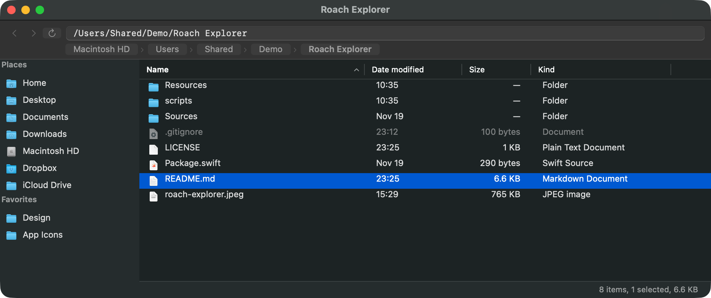

# Roach Explorer

A file manager for macOS, written in Swift and AppKit.

It is a working file manager, not a Finder clone: dense list, always-visible path, and the file operations you actually use. The behaviour is deliberately closer to Nautilus or Windows Explorer than to Finder in the places where that is the better habit — Return opens instead of renaming, the path is always on screen, and dragging a file into a terminal inserts a properly quoted path.

Work in progress. Built and used daily by one person, so it covers the operations that came up rather than every corner of the file system.



## Features

**Navigation**

- Path bar with two rows: an editable text field and clickable path segments. Tab completes names while typing.
- Back, forward, and up, including a two-finger swipe at the scroll edge.
- The open folder is watched, so changes made elsewhere show up without a reload.
- Places sidebar: Home, Desktop, Documents, Downloads, volumes, Dropbox and iCloud Drive, plus your own favourites.
- Always shows hidden files. No toggle to forget about.

**The list**

- Dense four-column list: Name, Date modified, Size, Kind. Folders first, click a header to sort.
- Icons, and a chain symbol on symlinks. Bundles like `.app` are one row, not a folder you can wander into.
- Selection with a status bar showing item count, selection count, and selection size.

**File operations**

- New folder with an inline editor and a generated name, new empty file, rename with the stem preselected, duplicate as `name copy`.
- Copy, cut, and paste. Cut dims the rows and does nothing until you paste. Escape cancels.
- Move by dragging, copy by dragging with Option. Drop onto a folder row, a path segment, or a sidebar item.
- Move to Trash, and Delete Immediately from the context menu for the cases where Trash is not what you meant.
- Undo and redo for paste and move. An operation that replaced an existing file is not undoable, and says so.
- Name collisions ask Replace, Keep Both, or Skip, with *apply to all* on by default. Nothing is overwritten silently.
- Long copies and moves run off the main thread with a progress panel, Cancel, and *Decide on collisions now* so a long run does not stop ten minutes later to ask.
- Cross-volume moves copy first and delete only when the copy has finished cleanly.

**Getting at things**

- Quick Look with Space, Get Info with `Cmd+I` for one item's details or a multi-selection summary — including the recursive size of folders.
- Permissions are editable in the Info window by clicking the mode bits.
- Open With, including *Other…*, from the context menu.
- Filter the current folder by name with `Cmd+F`. It narrows what is listed; it never searches the disk.
- Drag a selection into Terminal, iTerm, or Warp and get a shell-escaped path: single quotes, embedded quotes handled, one argument per file.

## Shortcuts

| Action | Keys |
|---|---|
| Open | `Return`, `Cmd+O`, double-click |
| Open folder | `Cmd+Down` |
| Rename | `F2`, `Cmd+Return`, slow second click on the name |
| New folder | `Cmd+Shift+N` |
| New window | `Cmd+N` |
| Duplicate | `Cmd+D` |
| Cut / Copy / Paste | `Cmd+X` / `Cmd+C` / `Cmd+V` |
| Undo / Redo | `Cmd+Z` / `Cmd+Shift+Z` |
| Move to Trash | `Delete`, `Backspace` |
| Get Info | `Cmd+I` |
| Quick Look | `Space` |
| Filter | `Cmd+F` |
| Back / Forward | `Cmd+[` / `Cmd+]` |
| Enclosing folder | `Cmd+Up` |
| Reload | `Cmd+R` |
| Path field | `Cmd+L` |
| Run unknown file in Terminal | `Option+Return`, `Option+double-click` |

## Requirements

- macOS 14 or later
- Xcode or the Swift command line tools (Swift 5.10 or newer)

## Build

```sh
swift build -c release
.build/release/RoachExplorer
```

Or build it as a real app bundle and install it in `/Applications`:

```sh
scripts/make-app.sh
```

The bundle script builds the release binary, generates `AppIcon.icns` from `roach-explorer.jpeg` with `sips` and `iconutil`, copies `Resources/Info.plist`, and ad-hoc signs the result. The app is not sandboxed, so it can open anything you can; opening it from Finder is why the ad-hoc signature is there.

Set `ROACH_START_PATH` to start in a particular folder instead of the last one used:

```sh
ROACH_START_PATH=~/Projects .build/release/RoachExplorer
```

## How it is put together

Swift Package Manager, one executable target, no dependencies outside the system frameworks. AppKit throughout: `NSTableView` for the list, `NSMenu` for the menus, `NSWorkspace` for launching, `NSPasteboard` for drag and drop.

```
Sources/RoachExplorer/
  main.swift              NSApplication bootstrap
  AppDelegate.swift       menus, window lifecycle
  WindowController.swift  one window, one folder: navigation, operations, undo
  Core/
    FileSystem.swift      directory scan, item model, sorting
    FileTransfer.swift    copy and move, collisions, progress, cancellation
    FileClipboard.swift   the cut and copy state on the pasteboard
    Drag.swift            drag operations, drop targets, shell quoting
    Summary.swift         recursive size walks
    Permissions.swift     mode bits, without following symlinks
    CockroachName.swift   generated folder names
    Settings.swift        last path, window frame, favourites
    Format.swift          sizes, dates, kinds
  UI/
    FileTable.swift       the list, inline editors, drag source
    PathBar.swift         text field and segment buttons
    Sidebar.swift         places and favourites
    FilterBar.swift       the `Cmd+F` row
    InfoWindow.swift      details summary and permissions
    TransferProgress.swift the progress panel
    StatusBar.swift       counts and size at the bottom
```

Two design decisions worth knowing about:

**The pasteboard is the contract.** Dragging onto a terminal is why the app is native rather than a web view. Terminal.app reads `public.file-url`; iTerm and Warp read the string. The drag writes both, and the string is quoted for a POSIX shell so paths with spaces, quotes, or newlines survive.

**Settings are plain JSON** at `~/.config/roach-explorer/settings.json` — last folder, window frame, favourites. Not Application Support, easy to read and edit.

## Not here

No tabs, no icon view, no column view, no search across the disk, no aliases, no network browsing beyond what the sidebar exposes. Some of those are planned; the ones that are not are deliberate.

## Status and licence

Personal project, actively changing. There is no test suite yet, and the commit history is the development log.

MIT licensed — see [LICENSE](LICENSE). Copy it, fork it, change it, ship it. Attribution is the only thing the licence asks for.
