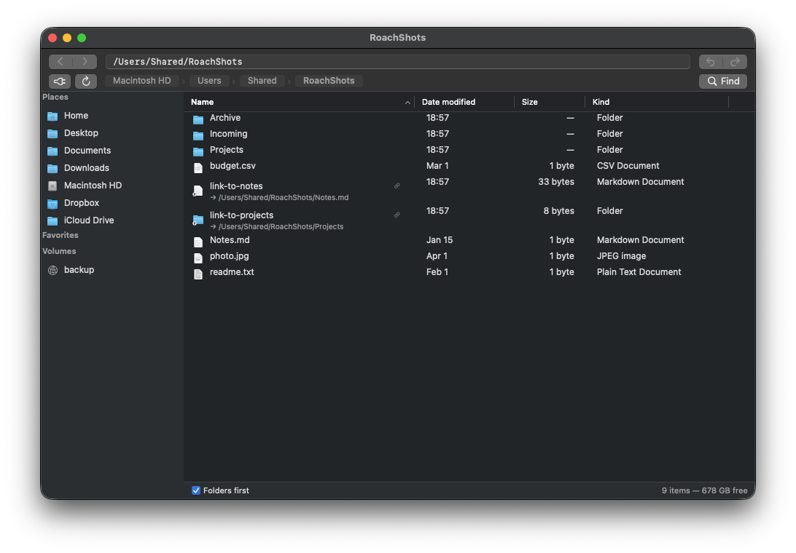
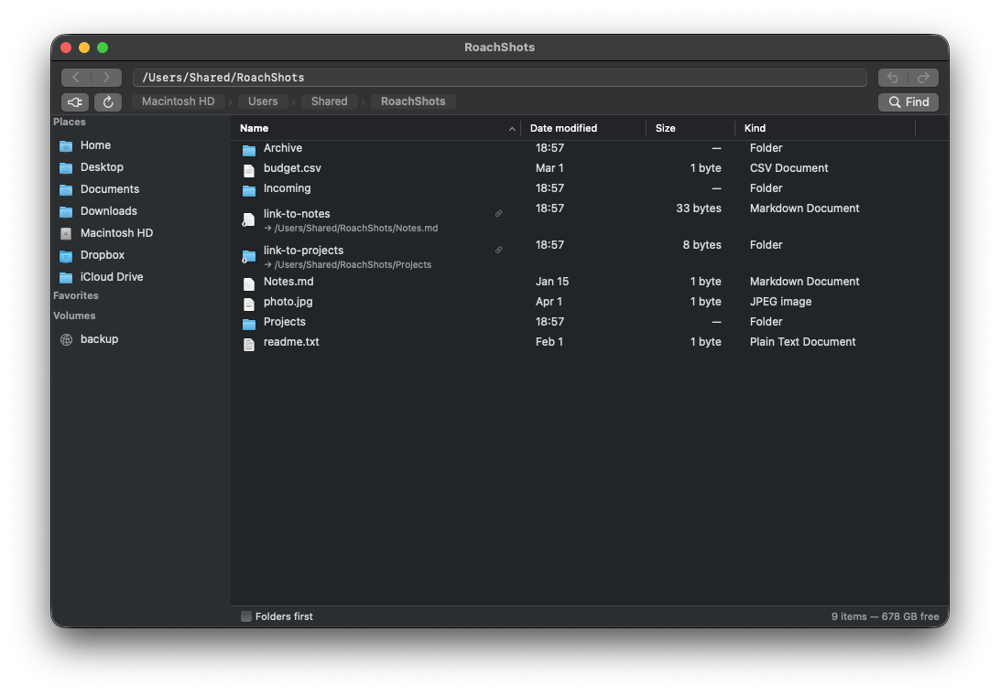
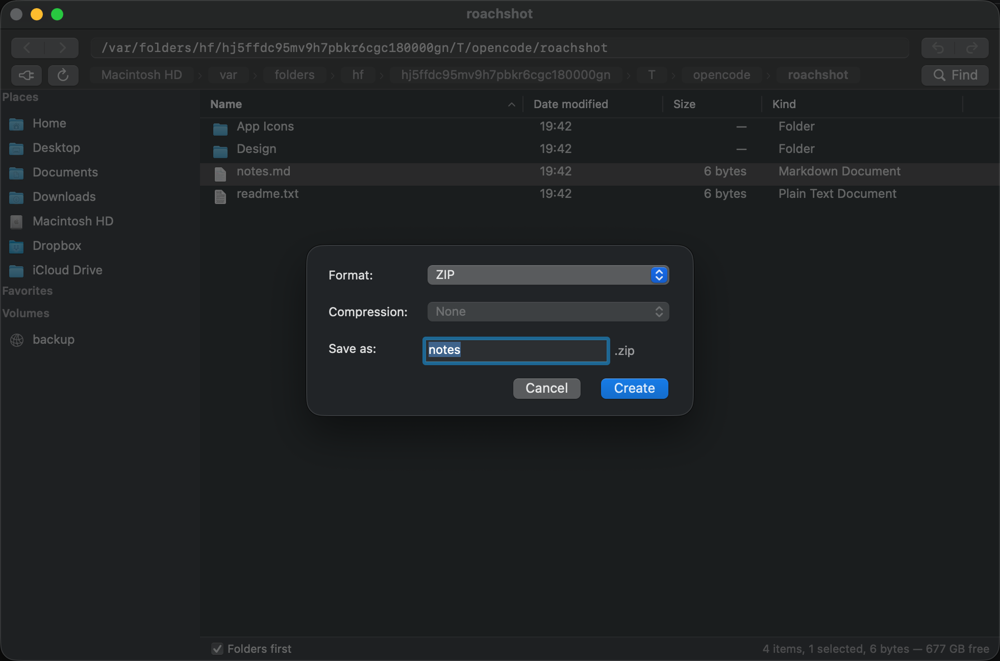
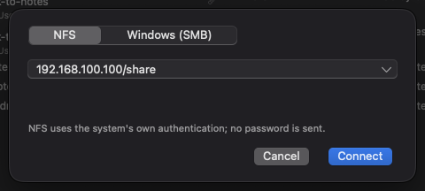
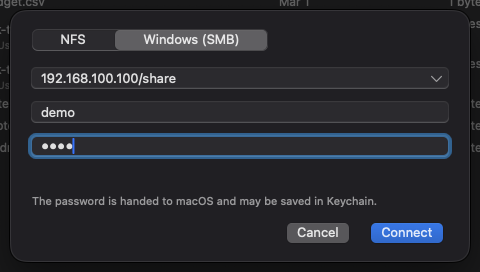

# Roach Explorer

[](https://github.com/HenzeLars/RoachExplorer/actions/workflows/build.yml)

A file manager for macOS, written in Swift and AppKit.

It is a working file manager, not a Finder clone: dense list, always-visible path, and the file operations you actually use. The behaviour is deliberately closer to Nautilus or Windows Explorer than to Finder in the places where that is the better habit — Return opens instead of renaming, the path is always on screen, and dragging a file into a terminal inserts a properly quoted path.

Work in progress. Built and used daily by one person, so it covers the operations that came up rather than every corner of the file system.



## Features

**Navigation**

- Path bar with two rows: an editable text field and clickable path segments. Tab completes names while typing.
- Back, forward, and up, including a two-finger swipe at the scroll edge.
- The open folder is watched, so changes made elsewhere show up without a reload.
- Places sidebar: Home, Desktop, Documents, Downloads, volumes, Dropbox and iCloud Drive, plus your own favourites.
- Always shows hidden files. No toggle to forget about.

**The list**

- Dense four-column list: Name, Date modified, Size, Kind. Click a header to sort.
- **Folders first** is a checkbox in the status bar. On, folders stay pinned above files in every order; off, everything is mixed and sorted by the active column — handy in Downloads sorted by date, where the newest thing should be on top whether it is a file or a folder.


- Each folder remembers its own view: sort column and direction, column widths, and the **Folders first** state. Tuned folders are kept in `folderViews.json`; a folder you never touched opens with the defaults.
- Icons, and a chain symbol on symlinks. A link row also shows where it points on a second line, resolved and with your home folder shortened to `~`. Bundles like `.app` are one row, not a folder you can wander into.
- Selection with a status bar showing item count, selection count, selection size, and the free space on the volume.

**File operations**

- New folder with an inline editor and a generated name, new empty file, rename with the stem preselected, duplicate as `name copy`.
- Copy, cut, and paste. Cut dims the rows and does nothing until you paste. Escape cancels.
- Move by dragging, copy by dragging with Option. Drop onto a folder row, a path segment, or a sidebar item. Rest on a folder row mid-drag and it springs open, so a destination three levels down is one gesture.
- Move to Trash, and Delete Immediately from the context menu for the cases where Trash is not what you meant.
- Undo and redo for paste and move. An operation that replaced an existing file is not undoable, and says so.
- Name collisions ask Replace, Keep Both, or Skip, with *apply to all* on by default. Nothing is overwritten silently.
- Long copies and moves run off the main thread with a progress panel, Cancel, and *Decide on collisions now* so a long run does not stop ten minutes later to ask.
- Cross-volume moves copy first and delete only when the copy has finished cleanly.
- Compress a selection into a **ZIP** or **TAR** archive — with no compression, gzip, bzip2 or xz — under an editable name. The archive lands in the current folder and is selected when it is ready; a name clash asks the usual Replace / Keep Both / Skip.



**Getting at things**

- Quick Look with Space, then Up and Down step through the folder with the preview following. Get Info with `Cmd+I` for one item's details or a multi-selection summary — including the recursive size of folders, the created date, and the owner and group. A summary does not claim one date or one owner; it shows a dash.
- Permissions are editable in the Info window by clicking the mode bits. The owner and group are read-only: changing them can need root.
- Open With, including *Other…*, from the context menu.
- Duplicate with `Cmd+D`.
- Make Alias, in the File menu and the context menu, writes a Finder-style alias next to the item: it keeps following the original when you rename or move it, unlike a symlink.
- Copy Path with `Option+Cmd+C` puts one path per line on the clipboard, ready for a shell. Nothing selected copies the open folder. Show in Finder and Open in Terminal are in the context menu, for when you want to leave.
- Find by name with `Cmd+F` or the magnifying-glass **Find** button. It filters the current folder by default; check **Include subfolders** to search recursively.
- Connect to a server with `Cmd+K`, the plug button in the path bar, or File ▸ **Connect to Server…**. NFS and Windows (SMB) shares mount without a trip through Finder; the sheet builds the address from host, share, username and password. The last 20 successful addresses are kept, with a dropdown and autocomplete — the username comes back, the password never does.



- Mounted shares, disk images and external disks get a **Volumes** section in the sidebar. Right-click one to eject it; ejecting the open folder leaves you in the nearest folder that still exists.
- Hold a dragged file over a sidebar row for a moment and the window opens that folder, so a deep destination is two gestures away without a sidebar tree.
- Drag a selection into Terminal, iTerm, or Warp and get a shell-escaped path: single quotes, embedded quotes handled, one argument per file.

## Shortcuts

| Action | Keys |
|---|---|
| Open | `Return`, `Cmd+O`, double-click |
| Open folder | `Cmd+Down` |
| Rename | `F2`, `Cmd+Return`, slow second click on the name |
| New folder | `Cmd+Shift+N` |
| New window | `Cmd+N` |
| Duplicate | `Cmd+D` |
| Cut / Copy / Paste | `Cmd+X` / `Cmd+C` / `Cmd+V` |
| Undo / Redo | `Cmd+Z` / `Cmd+Shift+Z` |
| Move to Trash | `Delete`, `Backspace` |
| Get Info | `Cmd+I` |
| Quick Look | `Space`, then `Up` / `Down` |
| Copy path | `Option+Cmd+C` |
| Find by name | `Cmd+F` |
| Connect to server | `Cmd+K` |
| Back / Forward | `Cmd+[` / `Cmd+]` |
| Enclosing folder | `Cmd+Up` |
| Reload | `Cmd+R` |
| Path field | `Cmd+L` |
| Run unknown file in Terminal | `Option+Return`, `Option+double-click` |

## Download

Tagged builds are attached to [releases](https://github.com/HenzeLars/RoachExplorer/releases). Unzip and drag `Roach Explorer.app` into `/Applications`.

The bundle is ad-hoc signed and not notarised, so the first launch has to go through right-click → *Open*, or System Settings → Privacy & Security → *Open Anyway*. After that it starts normally.

## Requirements

- macOS 14 or later
- Xcode or the Swift command line tools (Swift 5.10 or newer)

## Build

```sh
swift build -c release
.build/release/RoachExplorer
```

Or build it as a real app bundle and install it in `/Applications`:

```sh
scripts/make-app.sh
```

The bundle script builds the release binary, generates `AppIcon.icns` from `roach-explorer.jpeg` with `sips` and `iconutil`, copies `Resources/Info.plist`, and ad-hoc signs the result. The app is not sandboxed, so it can open anything you can; opening it from Finder is why the ad-hoc signature is there. `APP_DIR` overrides where the bundle lands and `VERSION` the version stamped into it — the release workflow sets both. Without `VERSION`, a local build takes the newest git tag, so About shows the same version the repository is at.

Set `ROACH_START_PATH` to start in a particular folder instead of the last one used:

```sh
ROACH_START_PATH=~/Projects .build/release/RoachExplorer
```

Set `ROACH_CONFIG_DIR` to keep settings somewhere else — useful for a test run that
should not write over your real favourites:

```sh
ROACH_CONFIG_DIR=/tmp/roach-test swift run RoachExplorer
```

The pure logic has tests:

```sh
swift test
```


## How it is put together

Swift Package Manager, one executable target and one test target, no dependencies outside the system frameworks. AppKit throughout: `NSTableView` for the list, `NSMenu` for the menus, `NSWorkspace` for launching, `NSPasteboard` for drag and drop.

```
Sources/RoachExplorer/
  main.swift              NSApplication bootstrap
  AppDelegate.swift       menus, window lifecycle
  WindowController.swift  one window, one folder: navigation, operations, undo
  Core/
    FileSystem.swift      directory scan, item model, sorting
    FileTransfer.swift    copy and move, collisions, progress, cancellation
    FileClipboard.swift   the cut and copy state on the pasteboard
    Drag.swift            drag operations, drop targets, shell quoting
    Alias.swift           Finder-style alias files, not symlinks
    Summary.swift         recursive size walks
    Permissions.swift     mode bits, without following symlinks
    CockroachName.swift   generated folder names
    Settings.swift        last path, window frame, favourites, per-folder views
    Format.swift          sizes, dates, kinds
  UI/
    FileTable.swift       the list, inline editors, drag source
    PathBar.swift         text field and segment buttons
    Sidebar.swift         places and favourites
    FilterBar.swift       the `Cmd+F` row
    InfoWindow.swift      details summary and permissions
    TransferProgress.swift the progress panel
    StatusBar.swift       counts, size, free space, folders-first toggle
Tests/RoachExplorerTests/
  RoachExplorerTests.swift  quoting, sizes, drop rules, cockroach names, aliases
```

Two design decisions worth knowing about:

**The pasteboard is the contract.** Dragging onto a terminal is why the app is native rather than a web view. Terminal.app reads `public.file-url`; iTerm and Warp read the string. The drag writes both, and the string is quoted for a POSIX shell so paths with spaces, quotes, or newlines survive.

**Settings are plain JSON** in `~/.config/roach-explorer/`. `settings.json` holds the last folder, the window frame, favourites and recent servers; `folderViews.json` holds the per-folder sort, column widths and **Folders first** state, most recently used first and capped at 100. Not Application Support, easy to read and edit.

## Not here

No tabs, no icon view, no column view, no file-content search, no network browsing beyond what the sidebar exposes. Some of those are planned; the ones that are not are deliberate.

## Status and licence

Personal project, actively changing. The pure logic has unit tests — path quoting, size formatting, the drop rules, generated names and aliases — and they run in CI on every push. Anything that needs a window is checked by hand. The commit history is the development log.

MIT licensed — see [LICENSE](LICENSE). Copy it, fork it, change it, ship it. Attribution is the only thing the licence asks for.
